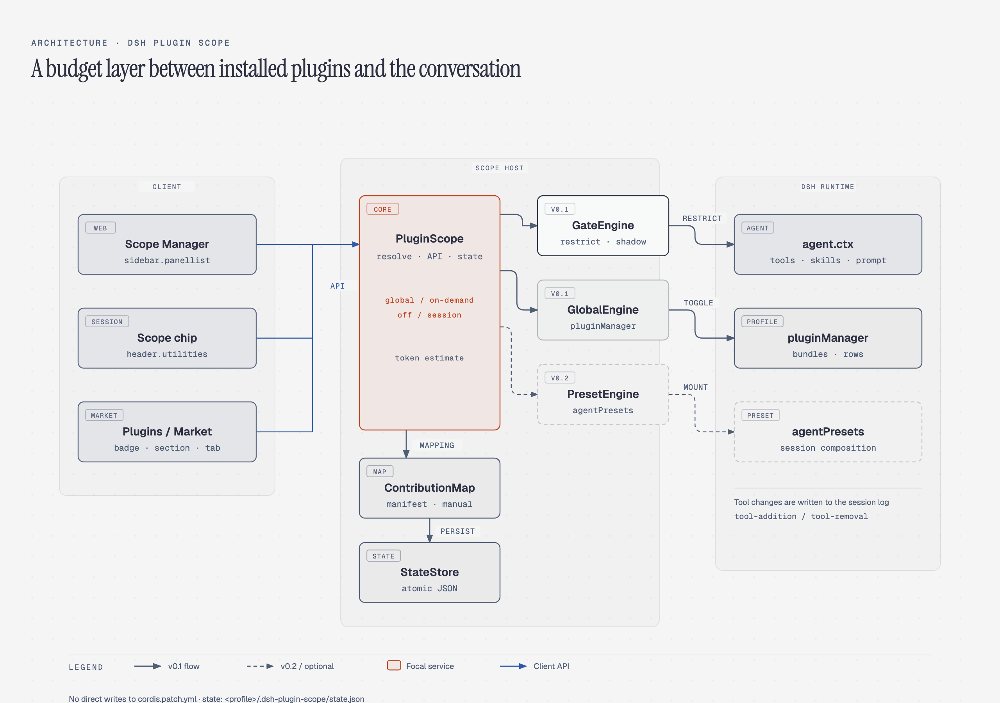

# Plugin Scope for DeepSeek Harness

> **v0.1.0 · Gate engine** — global / on-demand / off / per-conversation plugin scopes, with token estimates and integration with **dsh-market** and the native **Plugins** page.
> Design: [docs/DESIGN.md](docs/DESIGN.md) · Roadmap: [docs/ROADMAP.md](docs/ROADMAP.md) · Publishing: [docs/GITHUB.md](docs/GITHUB.md)

## The problem

DSH plugins are global by default: every installed plugin's tool schemas ride along on every request, even in conversations that never use them.
**Plugin Scope** adds a budget layer:

- **Global** — always available, e.g. the marketplace or the skills manager.
- **On demand** — visible only in conversations/profiles that select it; no tool-schema tokens elsewhere.
- **Off** — disabled in the profile, never loaded.
- **Session** — switch the current conversation's scope from a chip.

It also provides:

- Scope profiles (All / Minimal / Coding / custom);
- Per-plugin tool counts and token estimates;
- Integration with **dsh-market / the native Plugins page**: scope badges and direct global/on-demand/off controls;
- A mapping drawer: assign tools to a plugin; unmapped plugins stay Global and are never silently hidden.

## Install

### Local directory (development)

    dsh plugin --profile desktop add link:/Users/haozhanshi/WorkSpace/deepseek-work/plugin-scope

Or choose this directory in **Plugins → Add plugin**.

### GitHub release (after publishing)

    dsh plugin --profile desktop add https://github.com/UserShi/dsh-plugin-scope/releases/download/v0.1.0/dsh-plugin-scope-0.1.0.tgz

### npm (after publishing)

    dsh plugin --profile desktop add dsh-plugin-scope

## Usage

1. Open **Settings → Plugin Scope**, or **Plugins → Scopes**.
2. Choose **Global / On demand / Off** for each plugin.
3. Add on-demand plugins to the **Scope profiles** (Coding / Minimal / ...).
4. Use the **Plugin Scope** chip above the composer to switch the current conversation.
5. Click **Map tools** on a plugin to assign its tools. Unmapped plugins stay Global: no savings, but no broken conversations.

## How it works

1. Read the profile's bundles/rows through **dsh-plugin-manager** (never edit YAML by hand).
2. Map tools/skills to plugins via the built-in map, a plugin's **dsh.scope** manifest, or manual mapping.
3. On **agent/created**, apply **tools.restrict** / skill shadows / prompt-section shadows to **agent.ctx**.
4. Tool-set changes are logged by DSH as **tool-addition/removal**; sessions remain replayable.
5. Global toggles call **pluginManager.setBundleEnabled/setPluginEnabled**; HMR applies immediately, otherwise a restart is reported.

## Limitations

- Not a security sandbox: on-demand plugins still run in the Host process; v0.1 only guarantees **tool-schema** token savings.
- Skill/prompt-section shadows apply only where a mapping exists; unmapped plugins stay Global.
- No direct edits to **cordis.patch.yml**; all global changes go through **pluginManager**.
- Session scope selections live in the plugin's own JSON; model-visible changes are logged by DSH.
- Management plugins (this plugin, dsh-market, core packages) can only stay Global.

## Development

    npm test
    npm run check
    npm run pack

The repository is plain ESM JavaScript with no build step; lib/index.js is the Host half and lib/client.js is the browser half.

## License

MIT
