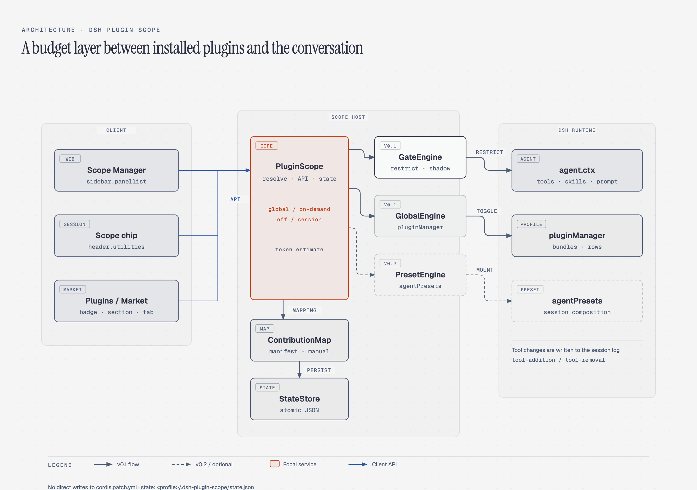

# Plugin Scope for DeepSeek Harness

> **状态：设计阶段（v0.1 草案）** — 尚未发布可安装版本。  
> 设计文档：[docs/DESIGN.md](docs/DESIGN.md) · 路线图：[docs/ROADMAP.md](docs/ROADMAP.md) · 发布说明：[docs/GITHUB.md](docs/GITHUB.md)

## 它解决什么问题

DSH 的插件一装就是全局：每个插件的工具 schema 都会进入每一次请求，哪怕这次对话根本用不到它。  
**Plugin Scope** 给 DSH 加一层「插件预算」：

- **Global**：所有对话常驻，例如市场、技能管理器。
- **On demand**：只在选了它的对话/模板里出现；不选就不占工具声明 token。
- **Off**：从 profile 禁用，彻底不加载。
- **Session**：在当前对话里临时勾选/取消插件。

同时提供：

- 作用域模板（Coding / Writing / Minimal / 自定义）；
- 每个插件的工具数量与 token 估算；
- 与 **dsh-market / 原生 Plugins 页** 结合：插件详情显示作用域徽章，并可直接设置全局/按需/关闭；
- 会话 header 的 Scope chip，随时切换本次对话的插件集合。



## 作用域模型

| 状态 | 何时加载 | 哪些对话可见 | 省 token |
|---|---|---|---|
| Global | profile 启动时 | 全部 | 否 |
| On demand | profile 启动时（v0.1 门控） | 选中它的对话 | 工具声明 |
| Off | 不加载 | 无 | 全部 |
| Preset（v0.2） | 仅选中它的对话 | 选中它的对话 | 全部 |

> v0.1 的 On demand 只保证工具声明不占 token；插件代码/路由/全局技能仍可能加载。  
> 真正的「完全不加载」是 v0.2 的 Preset 模式，需要插件是 preset-safe。

## 怎么工作（简述）

1. 启动时读取 profile 的 bundle / row 清单（通过 `dsh-plugin-manager`，不手改 YAML）。
2. 通过插件 manifest、手动映射或启发式，知道「哪个工具/技能属于哪个插件」。
3. 在 `agent/created` 时，对 `agent.ctx` 应用 `tools.restrict` / 技能遮蔽 / prompt section 遮蔽。
4. 工具集合变化由 DSH 自动写成 `tool-addition/removal`，会话可回放、可恢复。
5. 全局开关调用 `pluginManager.setBundleEnabled/setPluginEnabled`，HMR 下即时，否则提示重启。

## 计划中的使用方式

```bash
# 本地开发
dsh plugin --profile desktop add link:/absolute/path/to/dsh-plugin-scope

# GitHub Release（发布后）
dsh plugin --profile desktop add https://github.com/shihaozhan/dsh-plugin-scope/releases/download/v0.1.0/dsh-plugin-scope-0.1.0.tgz
```

然后在 **Plugins → Plugin Scope** 或侧边栏 **Plugin Scope** 中配置。

## 路线图

- **M0** 设计（当前）
- **M1** 可安装骨架：插件清单 + 只读页面
- **M2** Gate Engine + 会话 chip + token 估算
- **M3** 全局开关 + 原生 Plugins / dsh-market 集成
- **M4** 技能/prompt 门控 + Preset 完全隔离（v0.2）
- **M5** 发布

## 限制（请先读）

- 不是安全沙箱：按需插件仍然在 Host 进程运行。
- 工具归属无法 100% 自动发现；未映射插件默认保持 Global，不会静默隐藏。
- v0.1 不承诺隐藏第三方插件的全部 prompt/skill 贡献。
- 不会直接编辑 `cordis.patch.yml`；全局变更全部走 `pluginManager`。
- 会话作用域选择保存在插件自己的 JSON 中；工具/prompt 变化由 DSH 写入 session log。

## 开发（规划中）

当前仓库只有设计文档，代码尚未提交。以下是 M1 的目标工作流：

```bash
pnpm install
pnpm typecheck
pnpm test
pnpm build
```

## License

MIT
