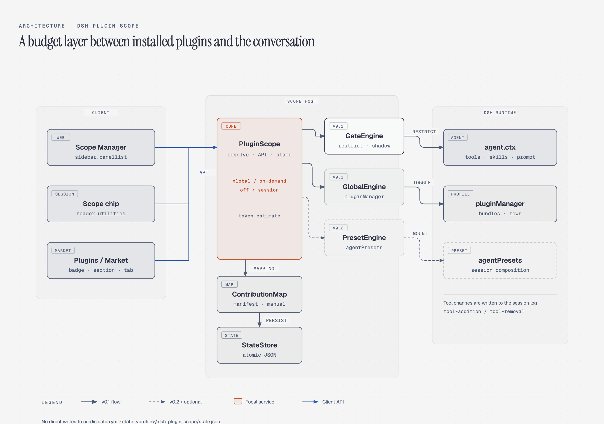

# DSH Plugin Scope — 设计说明

> 状态：**v0.1 设计草案**（尚未开始功能实现）  
> 目标运行环境：DeepSeek Harness **0.2.2-rc.5**，Desktop / Web profile  
> 文档日期：2026-11-19  
> 代号：`dsh-plugin-scope`（中文名「插件作用域」）

---

## 0. 一句话

**用一份作用域配置，决定每个插件在哪些对话中可见；不用的插件不占工具声明 token。**

它不是一个新的大模型能力，而是 DSH 插件系统的「预算层」：把「装了什么」和「这次对话要用什么」分开。

---

## 1. 背景与问题

### 1.1 DSH 当前的插件加载模型

DSH 的插件能力分成两个平面（这是设计的地基）：

| 平面 | 位置 | 生效范围 | 典型内容 |
|---|---|---|---|
| **Host / Profile** | `dsh.profile.bundles` + `cordis.patch.yml` | 整个 profile，所有会话 | 服务、Web 路由、客户端 UI、工具、技能、提示词 |
| **Agent Preset** | `@deepseek-ai/dsh-agent-preset` 声明 | 单个会话（创建时选择，首个 turn 后锁定） | 工具、persona、prompt section、技能、策略 |

现状：

- 一个插件安装后，它的工具 schema 会进入**每次请求**的 tool declarations；10 个插件、每个 3–8 个工具，首轮 prompt 很容易多出几千到几万 token。
- `@deepseek-ai/dsh-plugin-manager` 和 `dsh-market` 只能做**全局启用/停用**（写 `cordis.patch.yml` 的 `disabled` 或 bundle 选择），一关就是所有对话。
- Agent preset 可以做到「会话级组合」，但：
  - 需要手工写 YAML / 安装 bundle；
  - 首个 turn 后不能切换；
  - 对普通用户来说，概念太重；
  - 市场上安装的第三方插件通常直接挂在 Host 层，不会自动进入 preset。
- 用户没有直观的「这个插件这次对话到底占了多少 token」的反馈。

### 1.2 用户真正想要的三件事

1. **全局/按需**：有些插件（如市场、技能管理器）应该常驻；有些（如绘图、Office、某个 MCP）只在特定任务里用。
2. **单对话筛选**：在当前对话里勾选「这次要用哪些插件」，不用的插件不要出现在工具列表里。
3. **省 token 且可见**：能显示每个插件/每次对话的工具声明成本，以及关掉后省了多少。

---

## 2. 目标与非目标

### 2.1 目标（v0.1）

- 统一列出当前 profile 的所有 bundle / plugin row / 工具 / 技能，并标注来源与作用域。
- 支持四种作用域：**全局（global）**、**按需（on-demand）**、**关闭（off）**、**会话内临时（session）**。
- 支持「作用域模板」（Scope Profile），例如 Coding / Writing / Design / Minimal；新会话可选默认模板。
- 在会话 header / composer 提供作用域 chip，可在首个 turn 前切换；首个 turn 后仍可对**工具**做即时增减。
- 被排除的工具不再出现在该会话的 tool declarations 中；变更由 DSH 自动记录为 `tool-addition/removal`，可回放。
- 显示 token 估算：每个插件的工具 schema 成本、当前会话可见工具成本、预计节省。
- 与 `dsh-market` 及原生 Plugins 页结合：
  - 插件详情页显示作用域徽章；
  - 在插件详情页直接设置「全局 / 按需 / 关闭」；
  - 在 Plugins / Settings 中增加一个「Scopes」tab，和市场的 Discover tab 并列。
- 不直接改用户 YAML；全局变更全部走 `pluginManager`。
- 失败可诊断、可回滚，不因映射缺失破坏会话。

### 2.2 非目标（v0.1）

- **不是安全沙箱**：按需插件仍然在 Host 进程中加载并执行代码；作用域只控制「模型可见的贡献」和「是否加载」。
- 不替代市场的安装/卸载/更新。
- 不修改第三方插件的源码。
- 不做跨机器/团队共享（后续可导出 JSON）。
- 不承诺 100% 隐藏第三方插件的所有 prompt/skill 贡献；见 §8 的贡献映射限制。
- 不做按 token 预算自动调度模型（后续可扩展）。

---

## 3. 关键机制核实（DSH 0.2.2-rc.5）

以下结论来自本机安装包源码，不是猜测。

### 3.1 工具可以按 Agent 限制

`@deepseek-ai/dsh-tools` 的 `ctx.tools.restrict({ allow?, deny? })`：

- 只能在**有 scope 的 context**（`agent.ctx`）上调用；
- 作用于该 agent 继承的 **global + 祖先 scope** 工具；agent 自己 scope 上注册的工具不受限制；
- 多条 restriction 取交集；
- 未知工具名会抛错，因此调用前必须校验；
- 工具集合变化会触发 `tools/change`。

更关键的是，agent loop 在每次构造请求时比较前后 header 的工具名：

```ts
// dsh-agent-loop/src/agent.ts
const additions = tools.filter(tool => !previousNames.has(tool.name))
const removals = (baseline.tools ?? []).filter(tool => !currentNames.has(tool.name))
if (additions.length > 0 || removals.length > 0) {
  session.append('developer/message', { ... })
}
```

也就是说：**会话中途用 restrict 增删工具是合法的**，变更会写进 session log，恢复/回放/fork 都能重建。这是 v0.1 选择「门控」而不是「重挂载」的根本原因。

### 3.2 技能可以按 Agent 遮蔽

`@deepseek-ai/dsh-skill` 的注册表是 global + per-scope 分层：

- `ctx.skills.register(skill)` 注册到调用 context 的 layer；
- 读取时从 global 到最近 scope 依次覆盖，**同名时最近 layer 胜出**；
- `invocation.modelInvocable` / `userInvocable` 控制是否进入模型/用户目录。

因此可以在 `agent.ctx` 上注册一个同名的「空技能」：

```ts
agent.ctx.skills.register({
  name: 'diagram-design',
  description: 'hidden by plugin-scope',
  content: '',
  invocation: { modelInvocable: false, userInvocable: false },
})
```

它会遮蔽全局/祖先的同名技能，从模型目录里消失。代价是：需要知道技能名，且同名会误伤（见 §8）。

### 3.3 系统提示词 section 可以按 Agent 遮蔽

`@deepseek-ai/dsh-system-prompt` 同样是分层注册：

- `agent.ctx.systemPrompt.section({ name, text: '' })` 可以遮蔽同名全局/祖先 section；
- 空文本在渲染时被丢弃；
- 但注册表没有公开的「列出所有 section 名」API，所以需要贡献映射（§8）。

### 3.4 Agent preset 是真正的「会话级组合」

`@deepseek-ai/dsh-agent-preset-registry`：

- 每个 preset 是一个独立的 Cordis scope，插件 row 挂载在这个 scope 下；
- Agent 的 scope 被 parent 到 preset scope，因此 preset 内的工具/技能/提示词自动只对该 Agent 可见；
- `register(definition)` 可以在运行时注册新的 preset；
- `select(agent, id)` 只允许**空白会话**（没有 turn）切换；
- 会话日志记录 `agent-preset/selected`，恢复时按当前定义重建；
- preset 的插件如果发布全局服务会泄漏，挂载会被拒绝。

这意味着「完全隔离」是可行的，但要在 v0.2 做，且有兼容性门槛。

### 3.5 全局启用/停用有正式 API

`@deepseek-ai/dsh-plugin-manager`：

- `ctx.pluginManager.listBundles()` / `listPlugins()`
- `ctx.pluginManager.setBundleEnabled(name, enabled)`
- `ctx.pluginManager.setPluginEnabled(entryId, enabled)`
- 返回 `ChangeResult`，包含 `application`（applied / restart-required / failed / ...）与 `nextStep`；
- HMR 下即时生效，否则需要重启。

**不要**自己读写 `cordis.patch.yml`。这是硬约束，也是市场能安全工作的原因。

### 3.6 市场/插件页的可用插槽

原生 Plugins 页（`dsh-client-ui-plugin-manager`）公开：

| 插槽 | 类型 | 用途 |
|---|---|---|
| `plugins.detail.badge` | list | 详情页标题旁的徽章 |
| `plugins.detail.actions` | list | 详情页头部操作 |
| `plugins.detail.section` | list | 详情页正文下方的区块 |
| `plugins.tab` | list | Plugins 页的新 tab |
| `plugins.bundle.config` | keyed | 某个 bundle 自己的配置页 |
| `plugins.row.config` | keyed | 某个 row 自己的配置页 |

Settings 侧公开 `settings.plugins.tab`（Plugins 设置页的 tab）与 `settings.section`（设置页大页）。

`dsh-market` 自身注册了：

- `settings.plugins.tab`（市场设置页）
- `plugins.tab`（Plugins 页的 Discover tab）
- `plugins.detail.section`（源码仓库链接）
- `sidebar.panellist`（可选侧边栏入口）
- `shell.overlay`

**没有发现** dsh-market 为第三方提供「每个插件卡片上的操作插槽」。因此 v1 的集成方式是：

1. 在原生 Plugins 页的`plugins.detail.badge/actions/section`里注入作用域控制（市场安装的插件同样出现在这里）；
2. 增加一个自己的`plugins.tab` / `settings.plugins.tab`「Scopes」页，和市场的 Discover tab 并列；
3. v0.2 可向 dsh-market 提 PR，增加 `plugins.card.actions` 或公开 scope API，实现卡片内直接切换。

### 3.7 会话日志约束

DSH 的硬规则：**模型看到的内容必须能从 session log 重建**。

- 工具变化：agent loop 自动写 `tool-addition/removal`，满足。
- preset 选择：`agent-preset/selected`，满足。
- 我们自己的「会话 → 作用域模板」选择：**不是模型可见内容**，是插件状态；存插件自己的 JSON，不新增 session event 类型。
- 不能在 session 里 append 自定义 type（除非 `ignorable: true`，且 `appendPluginRecord` 只给实验包用）。

设计上要接受：**作用域选择本身不进 session log；作用域造成的工具/prompt 变化进 log。** 如果状态文件丢失，已恢复会话会回落到默认作用域——这是可接受的降级，但文档要写清楚。

---

## 4. 作用域模型

### 4.1 四种状态

| 状态 | profile 中是否加载 | 哪些会话可见 | token 成本 | 适用 |
|---|---|---|---|---|
| **global** | 是 | 所有会话 | 每次请求都有 | 市场、技能管理器、基础工具 |
| **on-demand** | 是（v0.1 门控） | 选了它的会话/模板 | 未选中的会话为 0（工具） | 绘图、Office、MCP、重工具 |
| **off** | 否（pluginManager 禁用） | 无 | 0 | 不用/排障 |
| **preset**（v0.2） | 否 | 选了它的会话 | 0；仅挂载时才有 | 重型插件、需要完全隔离 |

> 注意：v0.1 的 on-demand 只保证**工具声明**不占 token；插件代码、Web 路由、全局技能/提示词可能仍在。要「完全不加载」必须用 v0.2 的 preset 模式。

### 4.2 作用域模板（Scope Profile）

```json
{
  "id": "coding",
  "name": "Coding",
  "description": "日常编码：文件、shell、搜索、待办",
  "icon": "code",
  "plugins": ["dsh-ai-diagrams", "dsh-tool-office"],
  "tools": {
    "include": ["diagram_save", "diagram_png"],
    "exclude": ["office_render"]
  }
}
```

- `plugins`：模板包含的按需插件（bundle 名）。
- `tools`：可选的工具级 include/exclude；用于同一插件内只取一部分能力。
- 模板可标记为 `default`。
- 内置模板不写死；首次运行从当前已安装插件生成「All」「Minimal」两个初始模板。

### 4.3 会话作用域

```json
{
  "sessionId": "session-...",
  "profileId": "coding",
  "overrides": {
    "add": ["dsh-ai-diagrams"],
    "remove": ["dsh-tool-office"]
  }
}
```

有效集合的解析顺序：

1. 插件 `off` → 永不可见。
2. 插件 `global` → 可见。
3. 插件 `on-demand` → 仅当在 `profile.plugins + overrides.add - overrides.remove` 中。
4. 工具级 `exclude` 最后生效；`include` 可以把插件里默认不用的工具拉回来。
5. 未映射的插件 → 默认 `global`（fail-open），UI 标记「未映射，暂不能节省 token」。

### 4.4 默认作用域

- 新会话默认：用户设置的 `defaultProfileId`，否则「All」。
- 从已有会话 fork：读 `agent.session.header.parentSession`，查找父会话的 scope 记录；找不到则用默认。
- 子代理：默认继承父会话作用域（gate 通过 scope 链自动继承；preset 通过 `composeFrom` 继承）；可在设置中启用「子代理只用 Minimal」。

---

## 5. 总体架构



```text
┌──────────────────────────────────────────────────────────────────────┐
│ Web Client (React / slots)                                           │
│  · Scope Manager page (sidebar.panellist)                            │
│  · Session chip (conversation.session.header.utilities)              │
│  · Plugins page tab / Settings tab (plugins.tab)                     │
│  · Native plugin detail badge / section (plugins.detail.*)          │
└───────────────────────────────┬──────────────────────────────────────┘
                                │ same-origin JSON API
┌───────────────────────────────▼──────────────────────────────────────┐
│ Host: PluginScopeService                                             │
│  · InventoryAdapter  ← pluginManager.listBundles/listPlugins         │
│  · StateStore        ← <profile>/.dsh-plugin-scope/state.json       │
│  · Resolver          ← global / on-demand / off / session           │
│  · ContributionMap   ← manifest + manual + heuristic + scan         │
│  · TokenEstimator    ← ctx.tools.schemas(scope)                     │
│                                                                      │
│  ┌──────────────┐  ┌──────────────┐  ┌───────────────────────────┐  │
│  │ GateEngine   │  │ GlobalEngine │  │ PresetEngine (v0.2)       │  │
│  │ v0.1         │  │ v0.1         │  │ v0.2                      │  │
│  │ tools.restrict│ │ pluginManager│  │ agentPresets.register/    │  │
│  │ skill stubs  │  │ setBundle... │  │ select                    │  │
│  │ section shad.│  │              │  │                           │  │
│  └──────┬───────┘  └──────┬───────┘  └────────────┬──────────────┘  │
└─────────┼─────────────────┼───────────────────────┼─────────────────┘
          │                 │                       │
   ┌──────▼──────┐   ┌──────▼──────┐         ┌──────▼──────────────┐
   │ agent.ctx   │   │ profile     │         │ agent-preset scope  │
   │ restrict /  │   │ bundles &   │         │ mounted plugin tree │
   │ shadow      │   │ patch rows  │         │                     │
   └─────────────┘   └─────────────┘         └─────────────────────┘
```

### 5.1 组件职责

| 组件 | 职责 | 不做什么 |
|---|---|---|
| `PluginScopeService` | 状态、库存、解析、HTTP API、事件 | 不直接改 YAML |
| `InventoryAdapter` | 把 bundle/row/工具/技能转成统一记录 | 不安装/卸载 |
| `StateStore` | 原子读写 JSON、迁移、备份 | 不写 session log |
| `ContributionMap` | 插件 → 工具/技能/section/命令 | 不猜测着隐藏 |
| `GateEngine` | 把有效作用域落到 `agent.ctx` | 不重挂载插件 |
| `GlobalEngine` | 调 pluginManager 做全局开关 | 不复制市场逻辑 |
| `PresetEngine` | 生成/注册/选择会话 preset | 不强制所有插件 |
| `TokenEstimator` | schema 文本长度估算 | 不承诺与 tokenizer 完全一致 |

### 5.2 一次新会话的时序

```text
Client                    Host                         DSH
  │ create session          │                            │
  │────────────────────────▶│                            │
  │                         │ agent/created              │
  │                         │◀───────────────────────────│
  │                         │ resolve(session)           │
  │                         │  = default profile         │
  │                         │ apply GateEngine           │
  │                         │  agent.ctx.tools.restrict  │
  │                         │  agent.ctx.skills.register │
  │                         │  agent.ctx.systemPrompt... │
  │◀── state + estimate ────│                            │
  │ user picks "Coding"     │                            │
  │────────────────────────▶│ dispose old + apply new    │
  │                         │                            │
  │ user sends first msg    │ first step: tool diff      │
  │────────────────────────▶│───────────────────────────▶│
  │                         │                            │ tool-addition/removal
  │                         │                            │ written to session log
```

### 5.3 一次全局开关的时序

```text
Client → POST /plugins/:name/scope {scope:"off"}
      → GlobalEngine → pluginManager.setBundleEnabled(name,false)
      → ChangeResult {application:"applied"|"restart-required", nextStep}
      → StateStore 记录用户意图
      → Client 显示状态（不把"已保存"说成"已生效"）
```

---

## 6. 数据模型

### 6.1 文件位置

```text
<profile>/
  .dsh-plugin-scope/
    state.json          # 唯一事实来源（用户作用域配置）
    state.backup.json   # 写入前备份（保留最近 3 份）
    logs/
      scope.log         # 诊断日志（不含敏感信息）
```

- 使用原子写：临时文件 + rename。
- 读取时做 schema 校验；未知字段保留，未知版本拒绝写入并提示。
- 不使用 session event；不写 `cordis.patch.yml`。
- profile 目录从 `ctx.get('profileContext')?.dir` 解析；没有 profile（如 headless 无 profile）时进入只读模式，不落盘。
- 如果未来 `ctx.storageDomain` 可用，可迁移到 storage domain；v0.1 用文件以减少 peer 依赖。

### 6.2 Schema

```json
{
  "version": 1,
  "settings": {
    "mode": "gate",
    "defaultProfileId": "all",
    "autoApplyOnCreate": true,
    "showSessionChip": true,
    "subagentInherits": true
  },
  "plugins": {
    "dsh-ai-diagrams": {
      "scope": "on-demand",
      "profiles": ["design", "coding"],
      "contribution": {
        "tools": ["diagram_types", "diagram_save", "diagram_png", "diagram_svg", "diagram_validate", "diagram_import", "diagram_profile"],
        "skills": ["diagram-design"],
        "sections": []
      },
      "mappedBy": "manifest",
      "enabled": true,
      "version": "0.2.0"
    }
  },
  "profiles": [
    {
      "id": "all",
      "name": "All",
      "description": "所有按需插件",
      "builtin": true,
      "plugins": ["*"],
      "tools": { "include": [], "exclude": [] }
    },
    {
      "id": "coding",
      "name": "Coding",
      "description": "编码与文件操作",
      "plugins": ["dsh-ai-diagrams"],
      "tools": { "include": [], "exclude": [] }
    }
  ],
  "sessions": {
    "session-1ac065a4-...": {
      "profileId": "coding",
      "overrides": { "add": [], "remove": [] },
      "updatedAt": "2026-11-19T21:00:00+08:00"
    }
  },
  "meta": {
    "createdAt": "...",
    "updatedAt": "...",
    "lastDshVersion": "0.2.2-rc.5"
  }
}
```

### 6.3 键的稳定性

- **插件键**：bundle 包名（`name`），不是显示名、不是版本。
- **row 键**：`<package>#<entryId>`，用于高级覆盖；默认只到 bundle 级。
- **工具/技能键**：模型可见名称（稳定 API）；不用内部 id。
- **会话键**：session id；清理策略：保留 90 天或最近 500 条。

### 6.4 迁移

- 只做向前兼容的字段新增；`version` 递增时写迁移函数。
- 读取失败：不覆盖原文件；进入只读模式，UI 提供「导出/修复/重置」。
- 备份：每次批量变更前复制 `state.json`。

---

## 7. 作用域解析器

```ts
interface EffectiveScope {
  visibleTools: Set<string>
  hiddenTools: Set<string>
  hiddenSkills: Set<string>
  hiddenSections: Set<string>
  reasons: Map<string, string> // 每个决定的来源，供 UI 解释
}

function resolve(plugin: PluginRecord, session: SessionScope): PluginVisibility {
  if (plugin.scope === 'off') return hidden('off')
  if (plugin.scope === 'global') return visible('global')
  if (plugin.scope === 'preset') return session.preset === plugin.profile ? visible('preset') : hidden('not-mounted')
  // on-demand
  const inProfile = resolveProfile(session).plugins.includes(plugin.key)
  if (!inProfile) return hidden('not-in-session')
  const excluded = session.overrides.remove.includes(plugin.key)
  if (excluded) return hidden('removed-by-user')
  return visible('on-demand')
}
```

关键原则：

1. **显式 off 永远赢**。
2. **global 不被会话排除**；如果用户想在某会话排除一个 global 插件，UI 要提示「先改成按需」。
3. **未映射插件 fail-open**：不能因为不知道它贡献了什么就把它藏掉；否则会话会莫名其妙缺工具。
4. **每次决定都带 reason**：UI 显示「为什么这个工具不可见」，便于排障。

---

## 8. 贡献映射（Contribution Map）

这是整个插件最核心、也最容易被低估的工程问题。

### 8.1 为什么需要映射

DSH 的工具注册表**不暴露**「这个工具属于哪个插件」：

- `ctx.tools.register(definition)` 只记录 definition + when；
- `ctx.tools.definitions(scope)` 返回工具定义，没有 owner；
- `tools.restrict` 需要的是**工具名**，不是插件名。

技能和 prompt section 也一样：注册表有分层，但没有公开的「按 owner 列出」API。

### 8.2 四种映射来源

| 来源 | 优先级 | 说明 | 可靠性 |
|---|---|---|---|
| **manifest** | 最高 | 插件在 `package.json.dsh.scope` 声明自己的贡献 | 作者声明，最可靠 |
| **manual** | 高 | 用户在 Scope Manager 里把工具/技能拖到插件下 | 人工确认 |
| **heuristic** | 中 | 按包名/工具名前缀猜测，如 `diagram_*` ← `dsh-ai-diagrams` | 仅建议，需确认 |
| **unknown** | 最低 | 未映射；默认 global，不节省 | 安全兜底 |

### 8.3 建议的 manifest 标准

```json
{
  "name": "dsh-ai-diagrams",
  "dsh": {
    "scope": {
      "tools": ["diagram_types", "diagram_save", "diagram_png", "diagram_svg", "diagram_validate", "diagram_import", "diagram_profile"],
      "skills": ["diagram-design"],
      "sections": ["tool:diagram"],
      "commands": [],
      "presetSafe": true
    }
  }
}
```

- `tools` / `skills` / `sections` / `commands`：模型可见贡献的名称。
- `presetSafe`：是否可在 v0.2 的 preset 模式中挂载（无全局服务/路由/单例副作用）。
- 插件可以只声明一部分；未声明的走 manual/heuristic。
- 该字段不改变 DSH 行为，只被 Scope Manager 读取；对旧版本 DSH 完全无害。

### 8.4 对已安装插件的自动发现

1. 读取 profile 的 bundle 列表（pluginManager）。
2. 对每个 bundle，读取其 package.json：
   - 有 `dsh.scope` → 直接建映射。
   - 没有 → 进入 heuristic：
     - 包名 `dsh-tool-*` / `dsh-*-tool` → 按工具名匹配；
     - 工具名前缀与包名 slug 匹配；
     - 内置官方映射表（bash/fs/web/office/...）。
3. UI 显示「已映射 N / 未映射 M」；未映射不阻塞使用，只是不节省。
4. 提供「扫描贡献」高级动作（可选）：
   - 通过 pluginManager 临时 disable/ enable 一个插件，diff 全局工具列表；
   - 需要 HMR；会短暂影响其他会话；
   - 默认关闭，必须在 UI 里二次确认；
   - 永不扫描受保护插件。

### 8.5 工具级覆盖

- 用户可以在插件内勾选「只启用这几个工具」。
- 也可以在会话里临时把某个工具加回来（`include`）。
- 解析顺序：插件可见性 → 工具级 exclude → 工具级 include（include 可覆盖 exclude，但需显式）。

### 8.6 未映射插件的产品策略

- 默认：**保持 global**，UI 打黄色「未映射」标记。
- 用户在 UI 里明确把它设为 on-demand 时：
  - 如果有任何已知工具/技能映射，按映射隐藏；
  - 如果完全未知，提示「无法确定该插件贡献，暂不能节省 token；可手动映射」；
  - 不静默隐藏。
- 如果映射后某工具名在运行时不存在（插件升级/改名）：
  - 从 deny 集合里剔除；
  - 记录 warning；
  - UI 显示「映射已过期，请重新扫描」；
  - 不阻断 agent。

---

## 9. Gate Engine（v0.1 的主引擎）

### 9.1 应用时机

- `ctx.on('agent/created', ({ agent }) => ...)`：新 Agent 创建时应用默认/已存作用域。
- 用户修改会话作用域：Host API 收到后，找到 live agent（`ctx.agents.get(sessionId)`），dispose 旧 effect，应用新 effect。
- 全局插件状态变化：pluginManager 的变更结果返回后，刷新库存；如果某个插件从 enabled → disabled，live agent 上的 restrict 可能指向不存在的工具，需要重新计算（剔除未知）。
- 插件卸载：`ctx.effect` 自动清理。
- 监听 `tools/change` / `skills/change` 时只刷新估算与映射缓存，**不要重入 gate**；用一个 revision + 微任务防抖，避免自己触发的 change 造成循环。
- 外部（市场/pluginManager）改动插件状态时，重新读取 inventory；如果某个工具已不存在，从 deny 集合剔除。

### 9.2 工具

```ts
const scope = scopeOf(agent.ctx)
if (scope === undefined) return
// Use the parent scope: an agent's own registrations cannot be restricted.
const parent = scopeParentOf(scope)
const known = new Set(ctx.tools.definitions(parent).map(d => d.name))
const deny = [...hidden].filter(name => known.has(name))
if (deny.length === 0) return

const dispose = agent.ctx.effect(
  () => agent.ctx.tools.restrict({ deny }),
  'plugin-scope: tools',
)
disposers.set(agent.id, dispose)
```

注意：

- `agent.ctx.effect` 的 disposer 由 Agent 生命周期拥有；插件卸载时也要清理（双保险）。
- 不要用 `allow`，用 `deny`；否则会误伤其他插件后注册的工具。
- 用 `scopeParentOf(agent scope)` 的 `definitions` 计算可限制集合；agent 自己 scope 上注册的工具不能 restrict，直接传给 `restrict` 会抛错。
- 每次变更重新计算 known 集合；不要缓存跨插件的工具名。
- 一个 agent 只保留一个本次插件的 restriction；不要叠加多个，避免释放不干净。

### 9.3 技能

```ts
for (const name of hiddenSkills) {
  agent.ctx.effect(() => agent.ctx.skills.register({
    name,
    description: 'hidden by plugin-scope',
    content: '',
    source: 'runtime',
    invocation: { modelInvocable: false, userInvocable: false },
    provider: 'plugin-scope',
  }), `plugin-scope: skill ${name}`)
}
```

- 只对 `SkillSummary.provider === 'runtime'` 或 manifest 声明的技能生效；不要遮蔽用户本地技能，除非用户明确选择。
- 同名本地技能会被遮蔽；UI 要显示「该技能同时存在于本地目录」警告。
- 如果技能名不存在，注册 stub 仍会创建一个空技能（从目录里消失但也不存在），影响很小；但最好先 `ctx.skills.list({ scope })` 校验。

### 9.4 Prompt section

```ts
for (const name of hiddenSections) {
  agent.ctx.effect(() => agent.ctx.systemPrompt.section({
    name,
    order: 0,          // 会被同名覆盖，order 不重要
    text: '',
  }), `plugin-scope: section ${name}`)
}
```

- 只遮蔽 manifest 明确声明的 section 名；不要猜 `tool:bash` 之类的内部命名。
- 不遮蔽 `harness:identity` / `deployment:persona-prefix` / `deployment:persona-suffix`，除非高级设置明确允许。
- 空 section 会被渲染时丢弃，不占 token。
- 名称冲突：scoped section 会覆盖同名全局，但同 scope 内重复会抛错；去重。

### 9.5 失败处理

- 单个工具/skill/section 失败：捕获、记录、继续应用其余项。
- 整个 GateEngine 失败：不要让 `agent/created` 抛错；记录后 fail-open。
- UI 显示「本会话有 2 项门控未生效」，并提供重试。
- 不在 `agent/pre-step` 里做重活；只在创建/变更时计算。

---

## 10. Preset Engine（v0.2，完全隔离）

### 10.1 目标

- 未选中的插件**根本不加载**：省内存、省启动时间、省所有 token（工具/skill/prompt/路由）。
- 仍保持 DSH 的 session log / resume / fork 语义。

### 10.2 方案

1. 每个 Scope Profile 编译成一个 synthetic preset：
   ```ts
   await ctx.agentPresets.register({
     id: `scope:${profile.id}`,
     name: profile.name,
     description: profile.description,
     order: 100 + index,
     plugins: rows, // 从基础 preset 或 bundle patch 解析出的 EntryOptions[]
   })
   ```
2. 新会话（空白）由客户端调用：
   ```ts
   await ctx.agentPresets.select(agent, `scope:${profile.id}`)
   ```
   这会写 `agent-preset/selected` 并重建 composition。
3. 已有会话：锁定；UI 显示「完全隔离需要新对话」，但仍可用 GateEngine 做工具级即时调整。
4. 子代理：registry 的 `composeFrom` 自动继承父 preset；无需额外处理。
5. 重启恢复：Host 启动时从 `state.json` 重新注册所有 scope preset；session 的 `agentPreset` projection 能解析到同名定义。

### 10.3 rows 从哪来

两种来源，按插件能力选择：

- **基础 preset 子集**（推荐）：
  - 读取当前默认 preset 的 YAML（`agentPresets.readDocument(id)`）；
  - 用 `@deepseek-ai/cordis-plugin-include` 的 `entryListSchema` 解析；
  - 按 row 的 `id`/`name` 过滤出用户选中的行；
  - 保留 group/isolate/config/!!js 表达式。
- **bundle patch 解析**：
  - 读取 bundle 的 `dsh.bundle.patch`；
  - 展平 `insert` 行；
  - 只取 manifest 标记 `presetSafe: true` 的插件。

### 10.4 限制

- 插件必须在 preset 中可挂载：
  - 不发布全局服务（否则 leak 检查拒绝）；
  - 不注册全局 Web 路由（一个 profile 只能有一个）；
  - 不依赖 Host 单例状态；
  - 不重复注册同名工具导致冲突。
- 因此 v0.2 需要 `presetSafe` 白名单；不满足的插件继续走 gate 模式。
- preset 定义不在 profile YAML 里；如果我们的 state 丢失，已记录该 preset id 的会话将无法恢复。缓解：
  - 稳定 id + 启动重建；
  - state 备份；
  - UI 显示「该会话的作用域定义丢失」并提供回退到默认 preset。
- 运行时 `register` 会 eager mount 所有 scope preset；如果模板很多，启动成本上升。v0.2 可按需懒注册，但会话恢复需要定义已存在；需要权衡。

### 10.5 Gate vs Preset 对比

| 维度 | Gate（v0.1） | Preset（v0.2） |
|---|---|---|
| 兼容性 | 任何插件 | 仅 preset-safe |
| 工具 token | 省 | 省 |
| Skill/prompt token | 需映射才省 | 省 |
| 插件代码/内存 | 仍加载 | 不加载 |
| 会话中途切换 | 可以（工具即时） | 仅空白会话 |
| 实现复杂度 | 中 | 高 |
| 风险 | 低 | 中（服务泄漏/恢复） |
| 建议 | 默认 | 高级/重型插件 |

---

## 11. UI / UX

### 11.1 信息架构

```text
Sidebar
└── Plugin Scope（新页面）
    ├── Overview
    │   ├── 当前会话作用域
    │   ├── 工具 token：现在 / 全开 / 节省
    │   └── 默认作用域选择
    ├── Plugins（表格）
    │   ├── 搜索 / 过滤（全局/按需/关闭/未映射）
    │   ├── 每行：图标、名称、版本、作用域、工具数、token、状态
    │   └── 行展开：工具/技能清单、映射来源、编辑
    ├── Profiles（模板）
    │   ├── 卡片：Coding / Writing / Minimal / 自定义
    │   └── 编辑：勾选插件 + 工具级 include/exclude
    └── Advanced
        ├── 贡献映射（未映射/过期）
        ├── 导入/导出 JSON
        └── 重置 / 诊断日志
```

### 11.2 会话 chip

位置：`conversation.session.header.utilities`（首选）或 `conversation.composer.dock`（备选）。

```text
┌────────────────────────────────────────────┐
│  Scope: Coding · 12 tools · ~1.8k tokens  ▾ │
└────────────────────────────────────────────┘
```

点击弹出：

```text
┌────────────────────────────────────────────┐
│  This conversation                          │
│  ○ All (18 tools, ~4.2k)                    │
│  ● Coding (12 tools, ~1.8k)                 │
│  ○ Minimal (5 tools, ~0.6k)                 │
│  ─────────────────────────────              │
│  On-demand plugins                          │
│  ☑ dsh-ai-diagrams    7 tools              │
│  ☐ dsh-tool-office    4 tools              │
│  ☐ mcp:github         6 tools              │
│  ─────────────────────────────              │
│  [Apply]  [Manage scopes…]                  │
│  ⓘ 工具立即生效；技能/提示词变更在下一轮生效  │
└────────────────────────────────────────────┘
```

规则：

- **空白会话**：应用 = 切换作用域（gate 或 preset）。
- **已开始会话**：应用 = 只改工具；技能/提示词若不支持即时，显示「下一轮 / 新对话」。
- 切换后 chip 立即更新；如果 API 返回 `restart-required`，显示明确状态。
- 不把「已保存」说成「已生效」。

### 11.3 Scope Manager 页面

表格列：

| 列 | 说明 |
|---|---|
| 插件 | 图标 + 名称 + 包名 |
| 状态 | enabled / disabled / restart-required / error |
| 作用域 | Global / On-demand / Off / Preset |
| 模板 | 哪些模板包含它 |
| 工具 | 数量 + token 估算 |
| 映射 | manifest / manual / heuristic / unknown |
| 操作 | 编辑、在市场打开 |

交互：

- 顶部搜索、过滤、批量选择。
- 行内切换作用域；Global/Off 调 pluginManager，On-demand 只改状态。
- 未映射插件用黄色标记；点击「映射」打开抽屉。
- 模板编辑用 checkbox 列表 + 搜索；保存后立即影响新会话，已有会话按规则。
- 底部 sticky bar 显示「3 个变更待应用」或「已应用」。

### 11.4 原生 Plugins 页 / dsh-market

- `plugins.detail.badge`：
  - `Global`（绿）/ `On-demand`（蓝）/ `Off`（灰）/ `Unmapped`（黄）。
- `plugins.detail.actions`：
  - 「Scope…」按钮，打开我们的详情抽屉/页面。
- `plugins.detail.section`：
  - 标题「Scope」
  - 三选一 radio：Global / On demand / Off
  - 模板多选：Coding / Writing / …
  - 说明：「Global 影响所有对话；On demand 只在选中模板的对话中可见。」
  - 变更按钮；显示 pluginManager 的 `application` 结果。
- `plugins.tab` / `settings.plugins.tab`：
  - 「Scopes」tab，和市场的 Discover tab 并列。
  - 页内是紧凑版表格 + 模板管理。
- 与市场的关系：
  - 安装/卸载/更新仍由市场负责；
  - 我们只读市场/pluginManager 的状态并写作用域；
  - 市场如果用自己的 profile preset 批量 disable，我们的 UI 要显示「被市场 preset 关闭」而不是「用户设为 off」。

### 11.5 Token 估算

```text
工具 schema token ≈ JSON.stringify({
  name, description, parameters
}).length / 4
```

- 粗略值，用于相对比较，不承诺与 tokenizer 一致。
- 每个插件显示「工具数 / 约 x tokens」。
- 当前会话显示「可见工具 / 全开工具 / 节省」。
- 非 live 会话：用 `agentPresets.acquireScope(presetId)` 拿到临时 scope key，计算后立即 dispose；不要长期持有。
- 技能/prompt section 若已映射，按文本长度估算，单独标注。
- 不把「省了 80%」当作精确承诺；用「约」和范围。

### 11.6 空/错/加载状态

- 无插件：空状态 + 「去 Plugins 安装」链接。
- 无模板：自动创建 All / Minimal。
- 映射为空：显示「未映射，暂不能节省 token」，不隐藏。
- API 失败：保留上次数据，顶部 banner + 重试。
- pluginManager 不可用：只读模式，隐藏全局开关，解释原因。
- preset 不可用：隐藏「完全隔离」选项。

### 11.7 可访问性与 i18n

- 使用 host theme token（`--dsw-alias-*`），不写死颜色。
- 不把 `@deepseek-ai/dsh-client-ui-primitives` 等 Client 包作为模块 import；需要控件时复制其 markup/CSS 行为，类名加本插件前缀，只保留 token 引用。
- 开关用 `role="switch" aria-checked`；radio 用原生 input；键盘可操作。
- 文案走 `ctx.locale`，至少 en / zh；不拼接句子。
- 图标原创或使用许可明确的素材。
- 不用 DOM hack / iframe；通过 slots 注册 React 组件。

---

## 12. 与 dsh-market 的集成

### 12.1 集成面

| 能力 | v0.1 | v0.2 |
|---|---|---|
| 插件详情徽章 | ✅ `plugins.detail.badge` | 保持 |
| 详情页作用域区块 | ✅ `plugins.detail.section` | 保持 |
| 详情页操作按钮 | ✅ `plugins.detail.actions` | 保持 |
| Plugins 页 Scopes tab | ✅ `plugins.tab` | 保持 |
| Settings 页 Scopes tab | ✅ `settings.plugins.tab` | 保持 |
| 市场卡片内直接切换 | ❌ 无公开插槽 | 向 dshmarket 提 PR 增加 `plugins.card.actions` |
| 市场安装后自动映射 | ✅ 读 manifest/heuristic | 保持 |
| 市场更新/卸载后状态保留 | ✅ 按包名保留 | 保持 |
| 市场 profile preset 冲突提示 | ✅ 读 enabled/disabled | 保持 |

### 12.2 不重复造轮子

- 安装、卸载、更新、构建脚本审批、版本兼容、快照：全部交给 `dsh-plugin-manager` / dsh-market。
- 我们只做「作用域」这一层，不复制市场的 profile 操作。
- 全局开关也走 `pluginManager`，不直接写 YAML；这样市场的快照、回滚、HMR 逻辑仍然有效。

### 12.3 冲突处理

- 市场把插件 disable 了，而我们记录的是 on-demand：
  - UI 显示「On demand（当前被市场禁用）」；
  - 不自动改用户配置；
  - 市场重新启用后，作用域自动恢复。
- 市场 profile preset 改了 bundle 顺序/选择：
  - 我们的插件键是包名，不受顺序影响；
  - 如果包被移除，标记 orphan；重新安装后恢复。
- 市场升级自己：我们的 client 插件不依赖市场包，插槽不存在时静默降级。

### 12.4 上游 PR（可选）

如果希望「在 dsh-market 的 Discover 卡片上直接设置作用域」，需要 dsh-market 提供：

- 一个 per-card action slot，例如 `plugins.card.actions`，props 带 bundle 包名和 enabled 状态；或
- 一个公开的 HTTP/service API，让第三方读取/写入 bundle 的 scope 元数据。

在 PR 合并前，v1 的 Scopes tab + 原生详情页已经能完成 90% 的工作。

---

## 13. API 设计

### 13.1 为什么用 HTTP routes 而不是 Typert Remote

- Typert Remote 需要生成 host/remote 类型产物，对第三方插件构建链要求高；
- `ctx.webServer.register` + 同源 `fetch` 的模式已被 `dsh-ai-diagrams` 等插件验证；
- 我们只需要一个小型 JSON API，不涉及大文件/流。

v0.2 如需类型安全，再迁移到 `TypertRemoteService`。

### 13.2 路由

前缀：`/api/dsh-plugin-scope`

| 方法 | 路径 | 作用 |
|---|---|---|
| GET | `/state` | 返回 `{ version, settings, plugins, profiles, session? , estimate }` |
| POST | `/plugins/:name/scope` | `{ scope, profiles?, tools? }` |
| POST | `/session/:id/scope` | `{ profileId, overrides? }` |
| POST | `/profiles` | 创建/更新模板 |
| DELETE | `/profiles/:id` | 删除模板 |
| POST | `/mapping/:plugin` | 保存贡献映射 |
| POST | `/scan` | 可选：扫描贡献（危险动作，二次确认） |
| GET | `/estimate?session=` | 估算 |
| GET | `/diagnostics` | 版本、错误、日志尾部 |

### 13.3 请求安全

- 默认仅接受 loopback 请求（`127.0.0.1` / `::1`），与 `dsh-ai-diagrams` 的 preview 路由一致；远程访问是显式配置项，并依赖 DSH 自身的认证。
- 仅接受同源请求：校验 `Origin` / `Sec-Fetch-Site`（若有）。
- 只接受 `application/json`，body 上限 256 KiB。
- 校验 method、路径参数、schema；错误返回 `{ error: { code, message, details? } }`。
- 不返回文件内容、不返回密钥、不执行用户输入。
- 写操作串行化（避免并发覆盖 state）。
- 日志脱敏。

### 13.4 刷新模型

- 每次写操作返回新的 `revision`。
- 客户端在挂载、窗口 focus、写操作后拉取 `/state`。
- 可选 SSE `/events` 推送 `revision`；v0.1 用轮询/焦点刷新即可。
- 不做高频轮询；最多 5s 一次，且页面隐藏时停止。

---

## 14. 安全与可靠性

### 14.1 受保护插件

永远不允许通过本插件关闭：

- `dsh-plugin-scope` 自己
- `@deepseek-ai/dsh-plugin-manager`（管理面）
- `@deepseek-ai/dsh-host-webserver` / `dsh-web-app` / `dsh-agent-loop` / 模型 provider
- 市场（`dshmarket`）—— 如果关掉市场，用户可能失去安装入口；至少二次确认
- pluginManager 返回 `readOnlyReason` 的行

UI 显示「受保护：管理插件」并禁用开关。

### 14.2 失败语义

- 写 state 失败：不改变内存状态；返回错误。
- pluginManager 失败：保留用户意图，但显示 `application: failed` 与 `nextStep`；不要假装成功。
- gate 失败：fail-open + 诊断；不阻断会话。
- preset 挂载失败：该模板标记 broken；不允许新会话选择；已有会话保留旧 revision。
- 进程重启：从 state 重建；如果 schema 不兼容，只读模式。

### 14.3 回滚

- 每次批量变更前备份 `state.json`。
- 全局变更由 pluginManager 负责；市场自己有快照。
- 提供「重置所有作用域」：所有插件恢复 global，清空会话覆盖；二次确认。
- 提供「导出 state.json」用于手工修复。

### 14.4 性能

- 库存只在启动、pluginManager 变更、页面请求时读取；不订阅所有事件。
- 映射缓存在内存，state 变更时失效。
- token 估算按需计算，缓存 30s。
- 不在 `agent/pre-step`、`llm/stream` 里做重活。

---

## 15. 仓库结构与技术选型

```text
dsh-plugin-scope/
├── package.json
├── cordis.patch.yml
├── tsconfig.json
├── tsdown.config.ts
├── vitest.config.ts
├── src/
│   ├── index.ts                 # Host entry: apply()
│   ├── service.ts               # PluginScopeService
│   ├── inventory.ts             # pluginManager adapter
│   ├── resolver.ts              # scope resolution
│   ├── gate.ts                  # GateEngine
│   ├── global.ts                # GlobalEngine
│   ├── presets.ts               # PresetEngine (v0.2)
│   ├── mapping.ts               # ContributionMap
│   ├── token-estimate.ts
│   ├── state.ts                 # atomic store + migrations
│   ├── routes.ts                # HTTP API
│   ├── shared/types.ts          # shared with client
│   └── client/
│       ├── index.tsx            # client entry (window.__ModuleLoader__)
│       ├── app.tsx              # Scope Manager page
│       ├── session-chip.tsx
│       ├── plugin-section.tsx   # native plugin detail section
│       ├── badges.tsx
│       ├── styles.module.css
│       └── locale.ts
├── locale/
│   ├── en.json
│   └── zh.json
├── docs/
│   ├── DESIGN.md
│   ├── ROADMAP.md
│   ├── GITHUB.md
│   ├── DETAIL.md
│   └── assets/
│       ├── architecture.html
│       └── architecture.png
├── tests/
│   ├── resolver.test.ts
│   ├── gate.test.ts
│   ├── mapping.test.ts
│   ├── state.test.ts
│   └── routes.test.ts
├── icon.svg
├── LICENSE
├── README.md
└── README.zh.md
```

### 15.1 package.json 草案

```json
{
  "name": "dsh-plugin-scope",
  "version": "0.1.0",
  "description": "Per-conversation plugin scopes for DeepSeek Harness: global, on-demand, off, with token estimates and dsh-market integration.",
  "type": "module",
  "main": "lib/index.js",
  "exports": {
    ".": "./lib/index.js",
    "./client": "./lib/client.js",
    "./locale/*.json": "./locale/*.json",
    "./icon": "./icon.svg",
    "./package.json": "./package.json"
  },
  "files": ["lib", "locale", "docs", "icon.svg", "cordis.patch.yml", "README.md", "README.zh.md", "LICENSE"],
  "dsh": {
    "manifestVersion": 1,
    "bundle": { "patch": "./cordis.patch.yml" },
    "client": {
      "platform": "web",
      "inject": [
        "@deepseek-ai/dsh-client-locale",
        "@deepseek-ai/dsh-client-ui-conversation",
        "@deepseek-ai/dsh-client-ui-plugin-manager",
        "@deepseek-ai/dsh-client-ui-settings",
        "@deepseek-ai/dsh-client-ui-sidebar",
        "@deepseek-ai/dsh-client-ui-theme"
      ]
    }
  },
  "engines": { "dsh": ">=0.2.2-rc.5 <0.3.0" },
  "peerDependencies": {
    "@deepseek-ai/cordis": "^4.1.0",
    "@deepseek-ai/dsh": ">=0.2.2-rc.5 <0.3.0",
    "@deepseek-ai/dsh-scope": ">=0.2.2-rc.5 <0.3.0",
    "react": "^18.3.1"
  },
  "license": "MIT"
}
```

> 运行时只 import `@deepseek-ai/dsh-scope`（`scopeOf` / `scopeParentOf`）和 `@deepseek-ai/cordis` 的类型；工具/技能/提示词/agent 只做 type-only import，避免版本漂移。实际 peer 依赖以 DSH 安装包为准；不要硬依赖核心包的内部路径。

### 15.2 cordis.patch.yml

```yaml
- insert:
    - id: plugin-scope
      name: 'dsh-plugin-scope'
```

### 15.3 构建

- TypeScript + ESM。
- `tsdown` 产出 Host（`lib/index.js`）与 Client（`lib/client.js`）。
- Client 产物包裹为：
  ```js
  window.__ModuleLoader__.load({ id: 'dsh-plugin-scope', factory(require) { ... } })
  ```
- React 从浏览器模块表 `require('react')`，不打包重复 React。
- **提交 `lib/`**：这样 `github:user/repo` 安装不需要在用户机器上跑构建脚本（pnpm 11 可能拦截 `prepare`）。CI 校验 `lib/` 与 `src/` 一致。
- npm 发布用 `prepack` 构建；GitHub Release 附 `.tgz`。

### 15.4 测试

- Vitest；Host 单测用 mock Context。
- Client 组件用 Testing Library + jsdom（可选）。
- 路由测试用 fetch/undici。
- 不做依赖真实 DSH 的单元测试；E2E 手工/脚本在临时 profile 里跑。

---

## 16. 路线图

### M0 — 设计（本文件）

- 产出：设计文档、架构图、仓库骨架、GitHub 发布方案。
- 退出标准：用户确认核心语义（gate vs preset、作用域状态、市场集成范围）。

### M1 — 可安装的行走骨架

- Host：`apply()`、state store、`GET /state`、bundle 列表。
- Client：Scope Manager 页面能列出插件和当前状态（只读）。
- 安装到 desktop profile，验证 slot 注册、locale、icon。
- 退出标准：页面能看到 4 个已安装 bundle；无控制台错误。

### M2 — Gate Engine + 会话 chip

- 工具映射（内置官方表 + 手动映射）。
- per-agent `tools.restrict`；会话作用域 API；chip。
- token 估算。
- 退出标准：两个会话，A 隐藏 diagram 工具，B 保留；session log 出现 tool-removal/addition；刷新/重启后保持。

### M3 — 全局开关 + 市场集成

- Global/Off 通过 pluginManager；受保护列表；ChangeResult 展示。
- 原生插件详情 badge/section/actions；Scopes tab。
- 退出标准：在插件详情里切 Off，市场/Plugins 页状态一致；HMR/restart 提示准确。

### M4 — 技能/prompt 门控 + 完全隔离（v0.2）

- skill stubs、section shadows。
- preset engine + `presetSafe` 白名单。
- 上游 dsh-market PR（可选）。
- 退出标准：选中 preset 的会话只挂载所需插件；未选中插件零加载；恢复/fork 正常。

### M5 — 发布

- 文档、截图、示例、CI、Release、npm。
- 退出标准：全新 profile 一键安装并完成首次配置。

---

## 17. 测试与验收

### 17.1 单元

- resolver：global/on-demand/off/session 组合；未知插件 fail-open。
- mapping：manifest/manual/heuristic/unknown；过期工具名剔除。
- state：迁移、损坏、备份、原子写。
- token estimate：空、单工具、多工具、缓存失效。

### 17.2 集成

- 用假的 `ctx.tools`/`ctx.skills`/`ctx.systemPrompt` 验证 gate 注册/释放。
- 用假的 pluginManager 验证全局开关与错误传播。
- 路由：method、body、same-origin、错误码。

### 17.3 E2E（临时 profile）

1. 安装 dsh-plugin-scope + dsh-ai-diagrams。
2. 新会话 A：默认 All → 看到 diagram 工具。
3. 切到 Minimal → diagram 工具消失；session log 有 tool-removal。
4. 新会话 B：默认 All → diagram 工具仍在。
5. 全局把 dsh-ai-diagrams 设为 Off → 两个会话都消失；市场/Plugins 显示 disabled。
6. 重启 → 会话作用域保持；Off 状态保持。
7. 卸载 dsh-ai-diagrams → 映射变 orphan；重新安装 → 恢复。

### 17.4 验收标准（v0.1）

- [ ] 安装后出现在 Plugins 页，图标/标题/描述/详情正确。
- [ ] 能看到所有 bundle 与 row，状态与 pluginManager 一致。
- [ ] Global/On-demand/Off 三种作用域可设置并持久化。
- [ ] 会话 chip 可切换；工具变化在下一轮生效并写入 session log。
- [ ] 未映射插件不会被静默隐藏。
- [ ] token 估算显示相对节省。
- [ ] 原生插件详情页有作用域 badge/section。
- [ ] 不直接改写 `cordis.patch.yml`。
- [ ] 受保护插件不可关闭。
- [ ] 重启、刷新、会话恢复后状态一致。
- [ ] 错误有可见诊断，不阻断会话。

---

## 18. GitHub 发布方案

### 18.1 仓库

- 地址：`https://github.com/shihaozhan/dsh-plugin-scope`
- 可见性：public（设计阶段可先 private）
- 默认分支：`main`
- License：MIT（可改）
- Topics：`dsh`, `dsh-plugin`, `deepseek-harness`, `plugin-manager`, `scope`, `token-saving`

### 18.2 首次发布步骤

1. 本地初始化并提交（本次已完成）。
2. 在 GitHub 创建空仓库（不要勾 README/.gitignore）。
3. 二选一推送：
   - **SSH**（推荐）：把本机 `~/.ssh/id_rsa.pub` 加到 GitHub → Settings → SSH keys；然后：
     ```bash
     git remote add origin git@github.com:shihaozhan/dsh-plugin-scope.git
     git push -u origin main
     ```
   - **HTTPS + PAT**：创建一个 fine-grained PAT（仅此仓库，Contents: Read/Write）；然后：
     ```bash
     git remote add origin https://github.com/shihaozhan/dsh-plugin-scope.git
     git push -u origin main
     # 用户名 shihaozhan，密码填 PAT
     ```
4. 打 tag：
   ```bash
   git tag v0.1.0
   git push origin v0.1.0
   ```
5. GitHub Release：附 `npm pack` 生成的 `.tgz`。
6. 可选 npm：
   ```bash
   npm publish --access public
   ```
   之后可 `dsh plugin --profile desktop add dsh-plugin-scope`。

### 18.3 CI

`.github/workflows/ci.yml`：

- Node 22 / 24
- pnpm install --frozen-lockfile
- typecheck
- test
- build
- `npm pack --dry-run` 检查 files
- 校验 `lib/` 与 `src/` 一致（如果提交 lib）

`release.yml`：

- 触发：tag `v*`
- build → `npm pack` → GitHub Release 上传 `.tgz`
- 可选 `npm publish`（`NPM_TOKEN` secret）

### 18.4 安装方式

- 本地开发：Plugins → Add plugin → 选择仓库目录；或
  ```bash
  dsh plugin --profile desktop add link:/absolute/path/to/dsh-plugin-scope
  ```
- GitHub Release tarball：
  ```bash
  dsh plugin --profile desktop add https://github.com/shihaozhan/dsh-plugin-scope/releases/download/v0.1.0/dsh-plugin-scope-0.1.0.tgz
  ```
- npm：`dsh plugin --profile desktop add dsh-plugin-scope`

### 18.5 当前凭据状态

- 本机没有 `gh` CLI。
- `git` 已配置用户名/邮箱，但 GitHub 没有可用的 HTTPS 凭据。
- SSH key 存在，但 `ssh -T git@github.com` 返回 `Permission denied (publickey)`，说明公钥尚未加到 GitHub。
- 因此本次只能完成本地仓库与提交；推送需要用户完成上述任一条授权。

---

## 19. 风险与未决问题

| 风险 | 影响 | 缓解 |
|---|---|---|
| 工具归属无法自动发现 | 第三方插件难以省 token | manifest 标准 + 手动映射 + 启发式；未映射 fail-open |
| 技能/提示词未映射 | 部分 token 仍占用 | v0.1 明确只承诺工具；v0.2 补 skill/section |
| 同名技能误伤 | 用户本地技能被遮蔽 | 只对 runtime/manifest 技能；UI 冲突警告 |
| preset 服务泄漏 | 完全隔离模式挂载失败 | `presetSafe` 白名单 + 诊断；失败不影响 gate |
| 状态文件丢失 | 会话作用域回退 | 备份 + 默认作用域 + 可见提示 |
| pluginManager/HMR 差异 | 用户以为已生效 | 严格展示 `application`；restart-required 明确 |
| dsh-market 无卡片插槽 | 市场内不能直接切 | Scopes tab + 原生详情页；v0.2 提 PR |
| DSH API 变化 | 插件失效 | 只依赖公开 README/类型；engines.dsh 限定；CI 多版本 |
| 性能 | 库存/估算拖慢 | 缓存、事件驱动、按需计算 |
| 用户概念混淆 | global/on-demand/off 误解 | UI 文案 + 帮助 + 状态解释 |

### 待用户确认

1. 核心语义：v0.1 先做「门控省工具 token」，还是直接做「preset 完全隔离」？（建议先门控）
2. 仓库名/可见性/License：`dsh-plugin-scope`、public、MIT？
3. GitHub 授权：加 SSH 公钥，还是给 PAT？
4. 是否要 npm 发布？是否要中英双语 README？
5. 首批要重点适配的插件：dsh-ai-diagrams、dsh-tool-office、dsh-skills-manager、dshmarket、whale widget？

---

## 20. 附录

### 20.1 DSH 包/API 速查

| 能力 | 包 | API |
|---|---|---|
| 工具注册/限制 | `@deepseek-ai/dsh-tools` | `ctx.tools.register`, `ctx.tools.restrict`, `ctx.tools.definitions/schemas` |
| 技能 | `@deepseek-ai/dsh-skill` | `ctx.skills.register`, `list/snapshot/get` |
| 提示词 | `@deepseek-ai/dsh-system-prompt` | `ctx.systemPrompt.section/context/variable` |
| Agent | `@deepseek-ai/dsh-agent` | `ctx.agents.list/get`, `agent/created`, `agent.ctx` |
| Preset | `@deepseek-ai/dsh-agent-preset-registry` | `ctx.agentPresets.register/select/list/compositionInventory` |
| 插件管理 | `@deepseek-ai/dsh-plugin-manager` | `ctx.pluginManager.listBundles/listPlugins/setBundleEnabled/setPluginEnabled` |
| Scope 原语 | `@deepseek-ai/dsh-scope` | `scopeOf`, `createScope`, `bindScopeParent` |
| Client slots | `ctx.slots` | `inject`, `register`, `entries`, `subscribe` |
| 主题 | client | `--dsw-alias-*` tokens |
| 本地化 | `ctx.locale` | `register`, `bind`, `t` |

### 20.2 术语

- **Bundle**：一个 npm 包，声明 `dsh.bundle.patch`，可包含多个 plugin row。
- **Plugin row**：Cordis Loader 的一个 entry（`id` + `name` + `config`）。
- **Host 平面**：profile 级，所有会话共享。
- **Preset 平面**：会话级组合，首个 turn 后锁定。
- **Gate**：不重挂载插件，只按 agent 隐藏工具/技能/section。
- **Scope Profile**：一组按需插件 + 工具覆盖的命名模板。
- **Effective Scope**：某个会话最终解析出的可见集合。

### 20.3 参考源码位置（本机）

- `@deepseek-ai/dsh-tools`：`packages/core/tools`（安装包 `lib/` + `src/`）
- `@deepseek-ai/dsh-agent-preset-registry`：`packages/core/agent-preset-registry`
- `@deepseek-ai/dsh-plugin-manager`：`packages/boot/plugin-manager`
- `@deepseek-ai/dsh-client-ui-plugin-manager`：`packages/client/ui-plugin-manager`
- `@deepseek-ai/dsh-skill`：`packages/core/skill`
- `@deepseek-ai/dsh-system-prompt`：`packages/core/system-prompt`
- 安装目录：`/Applications/DeepSeek Harness.app/Contents/Resources/app.asar/dsh/node_modules/@deepseek-ai/`
- Profile：`~/.dsh/profiles/desktop/`

---

## 21. 结论

这个插件值得做，而且**技术路径是清晰的**：

- v0.1 用 **Gate Engine**：不改插件加载方式，只在 `agent.ctx` 上做工具/技能/section 的门控；工具变更由 DSH 自动写入 session log，安全、可回放、兼容性最好。
- 用 **Global Engine** 管全局开关，全部走 `pluginManager`，不碰 YAML。
- 用 **Contribution Map** 解决「工具属于哪个插件」的核心难题；manifest 优先，manual 兜底，unknown fail-open。
- 用 **Scope Profile + 会话 chip** 把复杂概念变成用户能理解的两个动作：「这个对话用哪套插件」「这个插件全开还是按需」。
- 用 **dsh-market / 原生 Plugins 页插槽** 做展示和快捷入口；v0.2 再考虑完全隔离 preset 和上游 PR。

下一步：确认 §19 的 5 个问题后，按 M1 → M2 → M3 实现，先让一个真实会话看到「关掉绘图插件后工具消失、token 下降、session log 可回放」。
